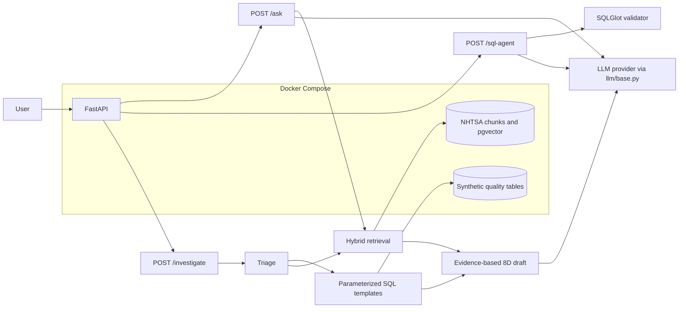

# RootCause

RootCause is an automotive quality copilot that gathers evidence about a
manufacturing issue and drafts an 8D report for human review. It uses public
NHTSA recalls and complaints (currently sampled from Ford, Toyota, and Honda)
and synthetic plant data. It uses no Mercedes-Benz data or internal company
material.

## Architecture



## Setup and run (PowerShell)

1. Copy `.env.example` to `.env` and set `GROQ_API_KEY` there. Keep `.env`
   private; it is excluded from Git and Docker build context.
2. Build and start the API and Postgres with pgvector:

   ```powershell
   Copy-Item .env.example .env
   # Edit .env and set GROQ_API_KEY before using LLM-backed endpoints.
   docker compose up --build -d
   ```

3. Create/reset the deterministic synthetic tables and the read-only SQL role:

   ```powershell
   docker compose run --rm app python scripts/generate_data.py
   ```

4. Fetch public NHTSA records, create chunks and embeddings, and store them in
   Postgres:

   ```powershell
   docker compose run --rm app python scripts/ingest.py
   ```

   Ingestion samples up to 2,000 topic-matching records across Ford F-150,
   Toyota Camry, and Honda Accord (2021 model year). It focuses on doors and
   seals, brakes, airbags, fuel, steering, and electrical issues. The raw API
   responses and local embedding model are cached under `data/`; ingestion
   replaces the stored document chunks on each run. The public API sources are
   the NHTSA [recalls](https://www.nhtsa.gov/nhtsa-datasets-and-apis) and
   [complaints](https://www.nhtsa.gov/nhtsa-datasets-and-apis) endpoints.

The synthetic data spans January 1 through June 30, 2025 and uses random seed
`2025`. It contains one deliberately injected spike: door-seal `seal gap`
defects at Cedar Falls, Line 3, from May 5 through May 18, 2025. The daily
spike count rises from 3 to 16, with higher severity and related downtime.

Check that the API is running:

```powershell
Invoke-RestMethod http://localhost:8000/health
```

Example requests:

```powershell
$body = @{ question = "What electrical issues are reported?" } | ConvertTo-Json
Invoke-RestMethod -Method Post -Uri http://localhost:8000/ask -ContentType "application/json" -Body $body

$body = @{ question = "Which plant and line had the most defects in 2025?" } | ConvertTo-Json
Invoke-RestMethod -Method Post -Uri http://localhost:8000/sql-agent -ContentType "application/json" -Body $body

$body = @{ issue = "Door-seal defects are spiking on Line 3 at Cedar Falls in May 2025" } | ConvertTo-Json
Invoke-RestMethod -Method Post -Uri http://localhost:8000/investigate -ContentType "application/json" -Body $body
```

To stop the services, run `docker compose down`. Add `-v` only if you also
intend to remove the local Postgres volume.

## API endpoints

| Method and path | Input | Purpose | Response |
| --- | --- | --- | --- |
| `GET /health` | None | Check API process health | `{"status":"ok"}` |
| `POST /ask` | `{"question":"..."}` | Retrieve public NHTSA evidence and answer with citations | Answer and source IDs/snippets |
| `POST /sql-agent` | `{"question":"..."}` | Answer a manufacturing data question with guarded SQL | SQL, rows, and short answer |
| `POST /investigate` | `{"issue":"..."}` | Gather data and document evidence and draft an 8D report | Validated 8D JSON and limitations |

Set `RETRIEVAL_MODE` to `hybrid`, `vector`, or `bm25` to compare document
retrieval methods. The local FastEmbed model needs no API key. LLM calls use the
configured provider through `app/llm/base.py`.

## Security

- The SQL agent connects using `rootcause_readonly`, which is provisioned with
  `SELECT` permission only on `production_defects` and `downtime_events`.
- SQL is parsed and validated before execution. The validator allows one
  `SELECT`, applies an allow-list for tables and functions, caps rows, and sets
  a statement timeout. PostgreSQL runs it in a read-only transaction.
- `UNION` is blocked, including for `/sql-agent`; investigation queries use
  fixed parameterized templates and combine defect and downtime results in
  Python.
- Tests cover malicious SQL, prompt injection (including requests to delete
  data or expose secrets), and the database role's inability to write.
- CI runs Ruff, pytest, pip-audit, Gitleaks, a Docker build, and a Trivy image
  scan. Tests use fake LLM providers and do not require API keys; the database
  role integration test uses a Postgres service.
- API credentials are read from environment configuration. Do not commit
  `.env` or put credentials in source code.

## Evaluation

Run the evaluation with:

```powershell
docker compose run --rm app python scripts/run_eval.py
```

To rerun only questions that failed or errored in the saved results, use
`docker compose run --rm app python scripts/run_eval.py --rerun-failed`. To
refresh `eval/failure_report.md` from saved responses without calling endpoints,
run `docker compose run --rm app python scripts/run_eval.py --failure-report-only`.

The script reads `eval/questions.json`, writes detailed results to
`eval/results.json` on the host, and compares vector-only, BM25-only, and hybrid
retrieval. Document questions with an empty `expected_keywords` list are
reported as unscored until expected terms are supplied. No evaluation scores
are claimed here; fill in this table from the generated `eval/results.json`.

| Measure | Result |
| --- | --- |
| SQL number match | _fill from eval/results.json_ |
| Document keyword hit rate | _fill from eval/results.json_ |
| Vector-only retrieval hit rate | _fill from eval/results.json_ |
| BM25-only retrieval hit rate | _fill from eval/results.json_ |
| Hybrid retrieval hit rate | _fill from eval/results.json_ |
| Combined evidence score | _fill from eval/results.json_ |

## Limitations

- The plant records are a small synthetic six-month sample, not production
  measurements.
- NHTSA ingestion is bounded and the relevance of retrieved public documents
  can be weak for a particular manufacturing issue.
- LLM use depends on the configured provider and its free-tier limits, latency,
  and model availability.
- Document evaluation uses keyword-based scoring; it does not measure factual
  correctness comprehensively.
- There is no independent verifier for generated answers or 8D reports. Reports
  are drafts and need human review.

## How I used AI coding assistants

AI coding assistants helped draft and refine implementation, tests, and
documentation. I reviewed the generated changes, checked library behavior
against documentation where relevant, and used tests and local checks to catch
errors. The assistant does not have access to private manufacturing records or
API credentials through this repository.

## Development checks (PowerShell)

```powershell
python -m pytest -q
ruff check .
```
